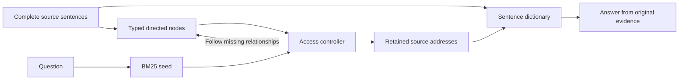

# Seshat: source-grounded external memory

A research prototype for preserving complete source sentences outside an LLM's working context and accessing them through typed, directed knowledge nodes. This repository is an English-language public showcase of ongoing Seshat journal research, with a runnable memory-mechanism example, the implemented synthetic method, and clearly scoped experimental evidence.

**Status:** the memory mechanism and a 64-question synthetic development experiment are complete. Evaluation on LongMemEval-S and LoCoMo is in progress. This is research software, not a published journal article or a validated state-of-the-art claim.

## Research question

How can a language model find and connect reliable evidence when the source history is larger than the context it can afford to read?

Seshat separates storage from access. Complete sentences remain in a host-memory dictionary; sentence and node identifiers are addresses. A controller reads a small set of typed facts, follows directed relationships when evidence is missing, retains the addresses of visited evidence, and rereads the original sentences before answering. An identifier is not a learned semantic token: the model still consumes the retrieved facts and source text.



## Run the example

Python 3.10 or newer is sufficient; the example has no external dependencies or network requests.

```bash
PYTHONPATH=src python examples/memory_walk.py
PYTHONPATH=src python -m unittest discover -s tests -v
```

The example follows `game → publisher → acquirer → closure year` and prints the retained source evidence. Its controller is scripted to demonstrate the mechanism. It does **not** run an LLM or reproduce model accuracy. The tests verify all 64 generated source cases, independent node parsing, directed links, invalid-address rejection, source retention, and trace replay.

For a model-backed experiment, the released `run_dictionary(case, tokenizer, call)` interface accepts a Qwen tokenizer and an instrumented generation adapter. See [reproduction requirements](docs/REPRODUCIBILITY.md). No model weights, personal conversation datasets, or API credentials are included.

## Completed synthetic development experiment

Frozen Qwen3-8B, greedy generation, thinking disabled, a 32K single-call window, and an 8K cumulative external-read ceiling. The same 64 cases contain 16 questions each about dates, negation, multiple relationships, and numeric inventory. Existing baseline predictions were reused for exactly the same IDs and verified source bindings.

| Method | Correct / 64 | Accuracy | Complete required evidence | Mean model calls | Mean input + output tokens |
| --- | ---: | ---: | ---: | ---: | ---: |
| Full source text | 41 | 64.0625% | 64 / 64 | 1.0000 | 615.4375 |
| Sentence dictionary | 49 | 76.5625% | 51 / 64 | 2.0000 | 427.2500 |
| Typed directed knowledge nodes | 58 | 90.6250% | 63 / 64 | 2.1875 | 701.2344 |

The node method gained nine correct answers over the dictionary baseline, with 11 wins, 51 ties, and two losses. It also consumed more tokens and external evidence. These are **synthetic development results**, not LongMemEval/LoCoMo scores, an equal-actual-cost comparison, or statistically established superiority. The synthetic node builder parses known sentence templates; it does not demonstrate general natural-language extraction quality.

See [results and limitations](docs/RESULTS.md), [aggregate results](results/synthetic64_summary.json), and [historical audit metadata](results/synthetic64_audit.json).

## Real-data evaluation in progress

The active research protocol evaluates all 500 LongMemEval-S questions and 1,540 LoCoMo category 1–4 questions. It compares BM25, Seshat knowledge nodes, and budget-adapted UnifiedMem flat and graph retrieval under a common frozen Qwen3-8B answer model, 32K window, and 8K external-read ceiling.

This evaluation is not complete. No final ranking is reported here. LongMemEval's local Qwen-judged accuracy is provisional; LoCoMo reports its official token F1 separately. Published scores with different models, judges, training, or filtering are literature references, not interchangeable leaderboard entries. See [benchmark protocol](docs/BENCHMARK.md).

## Scope and responsible research

Source-only construction, explicit source addresses, independent scoring, complete model-call accounting, and failure-preserving evaluation make the method inspectable. They do not by themselves establish factual reliability or responsible deployment. Errors remain in entity selection, arithmetic, stopping decisions, and natural-language extraction.

This public repository contains original method modules, synthetic fixtures, documentation, and aggregate results. The private development archive retains historical operational logs and the active HPC execution harness. See [release scope](docs/RELEASE_SCOPE.md) and [method](docs/METHOD.md).

## Use in a research portfolio

Suggested description: “An ongoing research software project investigating source-grounded long-term memory, typed knowledge nodes, and evidence-preserving iterative access for language models, with a completed controlled pilot and public-benchmark evaluation in progress.”

List this as research software or an ongoing project, separately from published papers. It currently has no journal acceptance or DOI.

## License

The code in this showcase is released under the MIT license. External datasets, model weights, and baseline implementations remain governed by their respective licenses and are not redistributed here.
